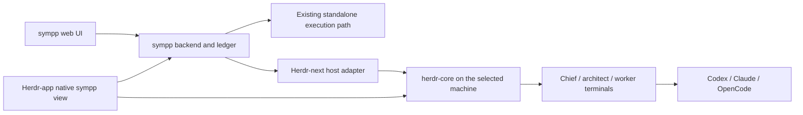

# sympp × Herdr-next

Status: optional native desktop integration. The backend and execution tooling
landed on sympp beta in #757–759; the native package is tracked in
[#760](https://github.com/JJLiebig/sympp/pull/760).
Qualification and current limits are recorded below.

## Product contract

sympp remains a standalone orchestration product with its normal graphical UI,
backend and supported execution workflows. Installing or using Herdr is not a
prerequisite for sympp.

Herdr-next is the name used here for **herdr-core + herdr-app**. It is not a
third application or a new fork. Inside that environment, sympp gains a native
view and an execution host for cross-provider work such as Codex → Opus and
Opus → Codex. OpenCode and other CLIs belong behind the same host boundary;
support is qualified per provider rather than inferred from its name.

Herdr-next also remains useful without sympp. A small fix can stay an ordinary
terminal conversation. sympp tracking and visualization are optional additions;
larger work can use the existing WorkRequest and WorkPackage workflow.

The native and web interfaces share sympp state. They do not create separate
backlogs, ownership records or delivery truth.

## Responsibilities

| Owner | Responsibility |
|---|---|
| sympp | Goals, packages, dependencies, assignments, decisions, delivery and evidence. |
| herdr-core | Agent processes, terminals, streams, persistence and machine connections. |
| herdr-app | Native views, navigation, focus and human controls. |
| Execution provider | Model/account access and its own conversation protocol. |
| GitHub/review providers | Their actual check, review, merge and delivery observations. |

Closing a Herdr-app window must not stop chiefs, workers or orchestration.
Multiple clients may view the same work and terminals. Client focus is not
ownership, and terminal activity is not proof of delivery.

## Human view

The primary question is **what needs me, and what happens next?** Following a
job and reaching its active agent should take very little navigation.

One `sympp` mod draws four levels: **Factory > Topic > Space > Job**.

- **Factory:** everything the connected sympp ledger holds, needs-you first.
- **Topic:** a company or domain and its optional chief. It summarizes relevant
  work and human decisions across repositories. Reuse personal topic grouping.
- **Space:** the work relevant to a repository on a machine. A cross-repository
  request can appear here as a reference to its one canonical goal.
- **Job:** one WorkRequest as a whole view. It opens beside the overview, or in
  its own tab (`props.job`) in the job's local space when a space folder matches
  one of its repositories, else in the shown space. Do not require a tab for
  every package or equate a package with an agent; architects, workers,
  reviewers and retries have different identities.

The Job level (the panel's drill-in, or the job's own tab) shows, from canonical
state only, in the web dashboard's visual language:

- **The task's strip and words:** one box per package, run by the architect's
  top-level groups (landed in a muted merge green, at work in its stage's colour,
  red while its checks fail, still to come hollow). A word appears only when
  something went wrong: Checks failing, Stuck, Review round 3 or a long review,
  Deploy failed, Parked, No recent report.
- **Asks first:** each outstanding ask from the board's `asks`, with one action:
  Answer in place when it has an answer route, else the topic's chief (a peek
  while it runs, otherwise Start chief). An unrecorded wait says its question
  isn't recorded, and only when no real question exists. A board without
  `asks` falls back to its escalations, guidance and open clarification
  questions.
- **Packages at work:** a row per package at work or waiting on the person, in
  planned order, with the dashboard's Build ─ PR ─ Checks ─ Review ─ Merge
  pipeline (work, then done without a PR); the PR step opens the pull request.
  A worker the board reports stale or not yet there is named; an unknown
  observation says nothing. Landed and queued packages fold into one mark each,
  opened on request. Agent, PR, Review and Studio sit behind selecting a row.
- **Review drill-down:** Review or Enter on a reviewed row opens the package's
  review under it: the provider's stage in plain words, its step ladder, the time
  in this round and overall, and each reported round newest first. Stale or
  missing reports say so.

The levels above a job:

- **Factory:** needs-you ranked by the unfinished packages that wait on each
  answer in the effective execution graph (a job-level ask holds all of its
  unfinished packages), then by age. Then one row per Herdr topic
  (`desk.topics`) with its needs, moving packages and repositories, plus
  unsorted spaces and work without a space when either has any. Each job has
  one home topic, its own repository's first, so it is counted once; other
  topics it touches name it as shared.
- **Topic and Space:** one view. A topic shows every task touching it, once; a
  space only the tasks on its repository. Each task is its name, its strip and
  any word for what went wrong, with its asks under it. What asks the person
  comes first, then what went wrong, then the rest, each by when it opened, so a
  task never moves just because it advanced. Planned and landed work folds into
  one shelf, and settled work stays in the dashboard. A chief space that fell out
  of its topic in `desk.topics` is put back there, where the desk keeps it
  unlisted.

A breadcrumb (Factory > Topic > Space > Job) and Esc move up a level; rows
take ↑/↓ and Enter. Each copy keeps its place in its own `localStorage`.
A panel copy follows Herdr's focus without taking it: an sympp-labelled terminal
or a job tab shows that job, else the space while sympp work touches it, else the
space's topic; focusing a mod pane keeps what it shows, and a pin stops it.
Job tabs record their Herdr tab in `shared("sympp.jobTabs")` while drawn, since
Herdr does not expose a mod pane's props. A toast posts only for a need that
appeared between two successful reads of one copy, never on the first read or
for an offline copy; copies share `shared("sympp.toasted")` so each need is
announced once. Clicking it selects the job's tab or opens one.

A UI package also has a **UI studio**: a tab named after the package in the
job's local space, holding its verified worker's terminal beside a preview. UI
work is a package titled with UI as a word, or one whose worker published
`sympp.preview_url`. Open UI studio on the package, or a scripted `tab.new` with
`props.studio` (the architect's path; a copy without an endpoint uses the
connection a connected copy shared), opens it; reopening selects it. The worker is
placed through `terminal.keep` only after the helper check; a worker another tab
shows moves only on the person's request. The preview is the published web page
as a link card (mods cannot embed a browser), else, for a local sympp worktree that
changes the Herdr view, that view built by the worktree's `preview.mjs` on sample
data as a `sympp-dev-*` mod that follows its saves; the real `sympp` mod is never
written. The copy is removed when the package lands or its studio closes. Studio
tabs carry a UI glyph through the desk tab bar's `workspace.tab_marks` slot.

A job can have multiple participating terminals; its identity remains the
WorkRequest rather than a particular client tab.
Preserve existing topics, compositions, terminal placement and normal Herdr
navigation. Xeneon hardware is a later surface, outside this delivery.

Keep needs-human work prominent, active work understandable and quiet work
quiet. Use stable positions, concise state labels and meaningful transitions.
Show stale or unavailable observations explicitly. Do not fabricate agent
thoughts, progress percentages, live status or cross-provider shared memory.

## Native surface

Herdr mods describe GPUI elements in JavaScript. They are native UI, without
HTML, CSS, DOM, Node or an embedded browser. The current sympp web implementation
under `elixir/assets/src/fresh/` remains the behavioral reference and continues
to ship as the standalone interface.

The native view should reuse sympp projections and semantics rather than porting
React components or replacing the web interface. Use Herdr theme tokens,
ordinary native controls, keyboard focus and existing terminal blocks.

The existing sympp `herdr-plugin.toml`, session focus commands and inspector
include legacy Herdr assumptions. They are not the Herdr-next adapter.

## Data and identity boundary

The read-only native hydrated-board endpoint is
`GET /api/v1/sympp/herdr/dashboard`, reusing the existing projection and native
consumer authorization. It does not migrate a ledger, register a dashboard
opener, change claims or weaken operator mutation authorization.

Do not spoof browser headers to call browser-authorized operator routes.
Native intake and question/guidance answers have a separate deliberate local
authority boundary: direct loopback and a local Host, no forwarding or browser
metadata, JSON only, and no native CORS/preflight grant. This authorizes a trusted
local process; it does not authenticate an application brand. Existing browser
authorization remains separate. The answer controls follow persisted prompt
options and canonical sympp validation.

The desktop transport uses Herdr's `fetch` for board/job reads and JSON actions.
Installed Windows Herdr-app 0.1.4 permits direct loopback GET and POST without
browser or forwarding metadata. This removes the HTTP helper, private request
files and one Node process per refresh; agent navigation/execution retains its
separate Node helper. Refresh stays modest (15 seconds for active work; 60 seconds
when quiet or in the background). The ordinary web UI remains available.

The native routes return JSON directly and never redirect. Herdr fetch may follow
same-origin redirects, but its
[redirect policy](https://github.com/herdrdev/herdr-app/blob/b975f5beaa6909cd7806a40096859c5e47938a19/vendor/gpui-kit/crates/shell/src/engine/quickjs/standard/fetch.rs#L341-L355)
refuses cross-origin redirects for non-GET methods (line 341) and requests with
caller-supplied headers (line 351). Every sympp request supplies `Accept`, and POST
also supplies JSON `Content-Type`. A response marked redirected or with a URL
different from the request fails before its payload is parsed or displayed.
Actual returned HTTP status is preserved, including on that failure; the view
does not retry uncertain writes. Browser mutation authorization is unchanged.

Reuse sympp's durable session-location observations where their identity is
applicable. Herdr-next bindings must retain the core/machine identity and full
terminal address, request/package/attempt identity and role. A last-known
location is not proof that an agent is alive. Do not infer generic provider
identity from legacy Codex-only bindings or from terminal text.

The shared projection exposes `runtime.offline`. Agent navigation requires an
explicit `false`, checks that capability again at activation, then verifies the
core, terminal, PID, launch and canonical request/package identity through the
trusted installed helper. A
Copy-and-View ledger can contain the same job IDs as the online source; copied
identities cannot authorize focus.

sympp loopback access is not a remote-access strategy. A remote backend requires
an explicitly supported authenticated connection, such as a managed tunnel;
never assume the app and all cores share one localhost or filesystem.

## Execution tooling

The optional Herdr-next execution host should launch a provider with the
existing scoped sympp assignment/bootstrap in its prepared workspace, then retain
the resulting native terminal binding. Ordinary Herdr terminals remain valid
without a ledger assignment.

Cross-provider handoffs carry the bounded task, durable decisions and evidence.
They do not promise to transplant one provider's private transcript into another.
Process host, role, model and conversation identity remain separate choices.

Reuse the existing direct-work and factory workflows. Native execution must
preserve assignment ownership, retry, cancellation and cleanup semantics. A
chief is an optional scoped agent, not a mandatory supervisor for every fix.
Automatic chief recovery is a separate capability: current Herdr reboot
recovery restores shells rather than restarting the original agent.

## Delivery slices and evidence

| Slice | Acceptance | State |
|---|---|---|
| Native read boundary | Same canonical board projection, local native policy, no reads causing writes; standalone routes unchanged. | Landed in [#757](https://github.com/JJLiebig/sympp/pull/757); 78 API acceptance cases and all required hosted gates passed. |
| Native working view | Real sympp state, topic/repo/job scope, attention and agent navigation using existing mod APIs. | Native rendering, intake typing and keyboard traversal passed in an isolated Windows home. A real intake and structured answer persisted in the canonical ledger. Agent placement passed through the public app API with an unchanged process; a physical click after that fix, compact layout and light theme remain unqualified. |
| Job level | Job tab, phase, needs-you strip, package rails, agents, decisions and keyboard, from canonical state; one mod split into flat modules. | Replaced by the Track view ([#816](https://github.com/JJLiebig/sympp/pull/816)); Factory chief presence remains. Open in [#766](https://github.com/JJLiebig/sympp/pull/766). Node tests cover phase, rails placement/order/axis, liveness, decisions cadence and tab placement; `herdr-app check --print-spec` checks the drawn structure at wide and narrow widths with fixtures. Wide and narrow, dark and light captures in an isolated Windows home and scratch core used a fixture backend. Not yet qualified: real ledger data, a Live agent with a real launch receipt, pointer and keyboard input, and layout switches, which follow window width at the next redraw. |
| Levels, panel and toasts | Factory, Topic and Space levels with a breadcrumb, a focus-following panel with a pin, and needs-you toasts, from canonical state and Herdr's own topics, spaces, focus and terminal reports. | Node tests cover placement, ranking, grouping, agents, following, toasts and navigation; `herdr-app check --print-spec` checks each level at wide and panel widths. An isolated Windows home and scratch core with a fixture backend showed the Factory (dark and light), a toast for a newly raised need, and a panel following a space, an sympp-labelled terminal and a topic; a job tab registered itself and `tab.select` reached it across spaces. Not qualified: real ledger data, pointer and keyboard input, and wide Topic and Space layouts in a live window (checked structurally only). |
| Track view | Topic, Space and task views in the web dashboard's language: box strips, asks with their own answer route or the topic's chief, words only for problems, stable order, folded landed and queued work, the per-package pipeline; replaces the rails, agents, decisions and chief-desk views. | [#816](https://github.com/JJLiebig/sympp/pull/816), on #819's asks and freshness. Node tests cover asks, freshness, strip grouping, order and folds; `herdr-app check --print-spec` checks the drawn structure wide and narrow. |
| Chief desk | A topic's registered chief, its dispatched work, recaps and waiting decisions, and chief presence on Factory rows, from #773's chiefs and attribution. | Replaced by the Track view ([#816](https://github.com/JJLiebig/sympp/pull/816)); Factory chief presence remains. Node tests cover topic matching (exact, leading or ending words, repositories, ambiguity), attribution, ordering, recaps, needs and chief liveness; `herdr-app check --print-spec` checks the desk, the no-chief line and Factory marks. An isolated Windows home and scratch core showed the desk, a no-chief topic, the Factory rows and the panel width with fixture data, dark and light. Not qualified: real registrations, a Live chief with a real session receipt, Open, and input. |
| UI studio | A UI package's tab with its verified worker beside a preview: a published web preview as a link card, or the worktree's own Herdr view live on sample data; a tab glyph through desk-tabs chrome 2. | Node tests cover UI detection, preview addresses, tab placement and hand-over, worker placement, preview choice, sweeping and the builder (sample-only entry, changed-only writes, base gating); `herdr-app check --print-spec` checks the Open UI studio button and each studio state. An isolated Windows home and scratch core, with stand-in workers carrying real launch labels and receipts the helper verified, showed a scripted studio placing a paneless worker on the left, the native preview following a save, the link card, duplicate hand-over, landing cleanup and the chrome 1 to 2 upgrade, dark, light and narrow. Not qualified: a real provider worker, a remote worker, pointer and keyboard input, and Open in a browser. |
| Native human actions | Intake and persisted question/guidance answers, with browser exclusion and canonical scope/status checks. | Landed in [#758](https://github.com/JJLiebig/sympp/pull/758); API/offline acceptance and all required hosted gates passed. |
| Native bindings/tooling | Explicit core/terminal/process bindings; optional direct work remains simple; correct focus and stale-state handling. | Landed in [#759](https://github.com/JJLiebig/sympp/pull/759); six controlled-core checks and all required hosted gates passed. Native receipt checks also reject mismatched canonical request/package IDs. |
| Hand-started sessions | Architects, coordinators and workers started in a native terminal report their location; Open verifies the actual MCP bridge as well as the terminal. | [#761](https://github.com/JJLiebig/sympp/pull/761) adds Node bridge discovery and private session receipts without changing worker launch receipts or core/app APIs. Existing bridge processes need a supported reconnect to load it; the PowerShell fallback remains legacy-only. |
| Cross-provider execution | Scoped launches and handoffs through herdr-core, provider qualification and recovery evidence. | Six controlled-core checks; real Windows Codex, Claude Opus and OpenCode launches and both fresh Codex/Opus handoffs passed in an isolated core. In-place sends to done/unknown agents remain unsupported by core 0.1.10. |
| Delivery qualification | Native view checked in an isolated home, owning source/hosted checks, review, packaged installation and real boundary evidence. | Twelve focused native tests, installed `herdr-app check` and FAST review passed. Installation into isolated and personal Herdr homes preserved layouts, topics and terminals. Exact-head hosted results are recorded in #760. Existing installed factories remain untouched; a new factory needs a fresh host session before use. |

This table records actual evidence as work lands. A design, source commit,
simulated fixture or healthy web interface alone does not qualify the native
integration or an installed execution provider.

The integration uses existing Herdr core/app model, commands and network grants.
Preserve live sessions, installed runtime identity and existing
standalone behavior throughout delivery.

The [native package guide](../../integrations/herdr-next/README.md) owns install
and opening commands. Installation preserves personal layouts and uses normal
Herdr mod tabs or split panes. The helper is installed as a script; this does
not turn a source checkout into the running sympp MCP backend. Existing factory
cutovers continue to follow the stopped-ledger procedure.

See [factory workflow](factory-workflow.md), [operator API](../operator-board-api.md),
[runtime](../runtime.md) and [testing](../testing.md) for their owning contracts.
