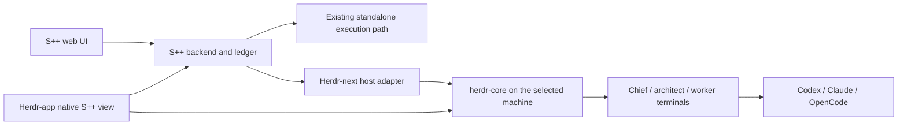

# S++ × Herdr-next

Status: target contract and active delivery plan. The native integration is not
yet delivered. Current source baseline: S++ beta `7b86b4b0`.

## Product contract

S++ remains a standalone orchestration product with its normal graphical UI,
backend and supported execution workflows. Installing or using Herdr is not a
prerequisite for S++.

Herdr-next is the name used here for **herdr-core + herdr-app**. It is not a
third application or a new fork. Inside that environment, S++ gains a native
view and an execution host for cross-provider work such as Codex → Opus and
Opus → Codex. OpenCode and other CLIs belong behind the same host boundary;
support is qualified per provider rather than inferred from its name.

Herdr-next also remains useful without S++. A small fix can stay an ordinary
terminal conversation. S++ tracking and visualization are optional additions;
larger work can use the existing WorkRequest and WorkPackage workflow.

The native and web interfaces share S++ state. They do not create separate
backlogs, ownership records or delivery truth.

## Responsibilities

| Owner | Responsibility |
|---|---|
| S++ | Goals, packages, dependencies, assignments, decisions, delivery and evidence. |
| herdr-core | Agent processes, terminals, streams, persistence and machine connections. |
| herdr-app | Native views, navigation, focus and human controls. |
| Execution provider | Model/account access and its own conversation protocol. |
| GitHub/review providers | Their actual check, review, merge and delivery observations. |

Closing a Herdr-app window must not stop chiefs, workers or orchestration.
Multiple clients may view the same work and terminals. Client focus is not
ownership, and terminal activity is not proof of delivery.

## Human view

The primary question is **what needs me, and what happens next?** Following a
job and reaching its active agent should take very little navigation.

- **Topic:** a company or domain and its optional chief. It summarizes relevant
  work and human decisions across repositories. Reuse personal topic grouping.
- **Space:** the work relevant to a repository on a machine. A cross-repository
  request can appear here as a reference to its one canonical goal.
- **Tab:** a job's working context, with its S++ view and participating
  terminals. Do not require a tab for every package or equate a package with an
  agent; architects, workers, reviewers and retries have different identities.
- **Focused job:** current outcome, next action, waiting reason, dependencies,
  packages, evidence and explicit ways to reach participating agents.

The exact tab/job default and visual composition are being designed with Opus.
Preserve existing topics, compositions, terminal placement and normal Herdr
navigation. Xeneon hardware is a later surface, outside this delivery.

Keep needs-human work prominent, active work understandable and quiet work
quiet. Use stable positions, concise state labels and meaningful transitions.
Show stale or unavailable observations explicitly. Do not fabricate agent
thoughts, progress percentages, live status or cross-provider shared memory.

## Native surface

Herdr mods describe GPUI elements in JavaScript. They are native UI, without
HTML, CSS, DOM, Node or an embedded browser. The current S++ web implementation
under `elixir/assets/src/fresh/` remains the behavioral reference and continues
to ship as the standalone interface.

The native view should reuse S++ projections and semantics rather than porting
React components or replacing the web interface. Use Herdr theme tokens,
ordinary native controls, keyboard focus and existing terminal blocks.

The existing S++ `herdr-plugin.toml`, session focus commands and inspector
include legacy Herdr assumptions. They are not the Herdr-next adapter.

## Data and identity boundary

The first backend addition is a read-only native hydrated-board endpoint at
`GET /api/v1/sympp/herdr/dashboard`, reusing the existing projection and native
consumer authorization. It must not migrate a ledger, register a dashboard
opener, change claims or weaken operator mutation authorization.

Do not spoof browser headers to call browser-authorized operator routes.
Native human actions need a deliberate supported authority path before their
controls become active.

GPUI fetch currently provides JSON/text, not a streaming response body. Begin
with a modest refresh schedule. A transport limitation alone does not justify
growing Herdr's universal API.

Reuse S++'s durable session-location observations where their identity is
applicable. Herdr-next bindings must retain the core/machine identity and full
terminal address, request/package/attempt identity and role. A last-known
location is not proof that an agent is alive. Do not infer generic provider
identity from legacy Codex-only bindings or from terminal text.

S++ loopback access is not a remote-access strategy. A remote backend requires
an explicitly supported authenticated connection, such as a managed tunnel;
never assume the app and all cores share one localhost or filesystem.

## Execution tooling

The optional Herdr-next execution host should launch a provider with the
existing scoped S++ assignment/bootstrap in its prepared workspace, then retain
the resulting native terminal binding. Ordinary Herdr terminals remain valid
without a ledger assignment.

Cross-provider handoffs carry the bounded task, durable decisions and evidence.
They do not promise to transplant one provider's private transcript into another.
Process host, role, model and conversation identity remain separate choices.

Reuse the existing direct-work and factory workflows. Native execution must
preserve assignment ownership, retry, cancellation and cleanup semantics. A
chief is an optional scoped agent, not a mandatory supervisor for every fix.
Automatic chief recovery is a separate capability: current Herdr reboot
recovery restores shells rather than restarting the original agent.

## Delivery slices and evidence

| Slice | Acceptance | State |
|---|---|---|
| Native read boundary | Same canonical board projection, local native policy, no reads causing writes; standalone routes unchanged. | In progress |
| Native working view | Real S++ state, topic/repo/job scope, attention and agent navigation using existing mod APIs. | Opus design in progress |
| Native bindings/tooling | Explicit core/terminal bindings; optional direct work remains simple; correct focus and stale-state handling. | Planned |
| Cross-provider execution | Scoped launches and handoffs through herdr-core, provider qualification and recovery evidence. | Planned |
| Delivery qualification | Native view checked in an isolated home, owning source/hosted checks, review, packaged installation and real boundary evidence. | Planned |

This table records actual evidence as work lands. A design, source commit,
simulated fixture or healthy web interface alone does not qualify the native
integration or an installed execution provider.

No Herdr core/app model, command or shared API growth is currently justified.
Any genuinely necessary expansion follows that repository's Can agreement
process. Preserve live sessions, installed runtime identity and existing
standalone behavior throughout delivery.

See [factory workflow](factory-workflow.md), [operator API](../operator-board-api.md),
[runtime](../runtime.md) and [testing](../testing.md) for their owning contracts.
