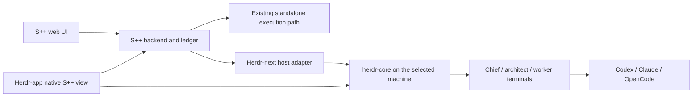

# S++ × Herdr-next

Status: optional native desktop integration. The backend and execution tooling
landed on S++ beta in #757–759; the native package is tracked in
[#760](https://github.com/JJLiebig/symphony-plus-plus/pull/760).
Qualification and current limits are recorded below.

## Product contract

S++ remains a standalone orchestration product with its normal graphical UI,
backend and supported execution workflows. Installing or using Herdr is not a
prerequisite for S++.

Herdr-next is the name used here for **herdr-core + herdr-app**. It is not a
third application or a new fork. Inside that environment, S++ gains a native
view and an execution host for cross-provider work such as Codex → Opus and
Opus → Codex. OpenCode and other CLIs belong behind the same host boundary;
support is qualified per provider rather than inferred from its name.

Herdr-next also remains useful without S++. A small fix can stay an ordinary
terminal conversation. S++ tracking and visualization are optional additions;
larger work can use the existing WorkRequest and WorkPackage workflow.

The native and web interfaces share S++ state. They do not create separate
backlogs, ownership records or delivery truth.

## Responsibilities

| Owner | Responsibility |
|---|---|
| S++ | Goals, packages, dependencies, assignments, decisions, delivery and evidence. |
| herdr-core | Agent processes, terminals, streams, persistence and machine connections. |
| herdr-app | Native views, navigation, focus and human controls. |
| Execution provider | Model/account access and its own conversation protocol. |
| GitHub/review providers | Their actual check, review, merge and delivery observations. |

Closing a Herdr-app window must not stop chiefs, workers or orchestration.
Multiple clients may view the same work and terminals. Client focus is not
ownership, and terminal activity is not proof of delivery.

## Human view

The primary question is **what needs me, and what happens next?** Following a
job and reaching its active agent should take very little navigation.

One `sympp` mod draws four levels: **Factory > Topic > Space > Job**.

- **Factory:** everything the connected S++ ledger holds, needs-you first.
- **Topic:** a company or domain and its optional chief. It summarizes relevant
  work and human decisions across repositories. Reuse personal topic grouping.
- **Space:** the work relevant to a repository on a machine. A cross-repository
  request can appear here as a reference to its one canonical goal.
- **Job:** one WorkRequest as a whole view. It opens beside the overview, or in
  its own tab (`props.job`) in the job's local space when a space folder matches
  one of its repositories, else in the shown space. Do not require a tab for
  every package or equate a package with an agent; architects, workers,
  reviewers and retries have different identities.

The Job level shows, from canonical state only:

- **Phase:** Shaping, Planning, Executing, Closing or Done, from the request
  status, dispatch and required-package delivery. No percentages.
- **Needs you:** only what the person can move: escalations and guidance,
  answerable in place.
- **Package rails:** one row per package on a shared real-time axis with a now
  line. Rows that need the person come first, then packages others wait on.
  Segments start only at recorded moments (creation, dispatch, review start,
  current stage entry, delivery) and are coloured by who is acting: the agent,
  CI or the person. Waiting is dimmed; a dependency wait is dotted and names its
  prerequisite. Stretches where nobody acted fold into a labelled break, and
  work that landed before the open work began is summarized rather than drawn.
  Review rounds are R1, R2, R3 chips, amber from round three. Work without a PR
  is work, then done. Each row gives wall time, time in its stage and time in
  its review. Narrow and panel widths stack a compact line per package.
- **Review drill-down:** a round chip, a road bump's Review button or Enter on
  a reviewed row opens the package's review beside the rails (under its row
  when narrow); Esc closes it and the rails keep their place. It shows the
  provider's stage in plain words, its step ladder, the time in this round and
  overall, and each reported round newest first with lane, step, outcome,
  start, finish and duration. Rounds older than the reported history are
  counted; finding counts appear only when recorded. Stale or missing reports
  say so. Without a ladder or history it shows step x/y and the round count.
  Round three or more than three hours in review is a road bump in the rails,
  the drill-down and the attention strip; a long review suggests reslicing,
  without acting on it.
- **Agents:** the architect, a worker per package with its active run attempt,
  and the review provider by type and mode. An agent is Live only after the
  trusted helper has just verified its exact launch and process; otherwise it
  shows its last S++ sighting or Unknown. A bound agent's own status report is
  shown as such, never inferred from terminal text.
- **Decisions and questions:** the job's recorded decisions, read only while a
  job view shows, and its clarification questions, answerable in place.

The Lens remains the overview beside the terminals until the Factory, Topic and
Space levels replace it. A job can have multiple participating terminals; its
identity remains the WorkRequest rather than a particular client tab.
Preserve existing topics, compositions, terminal placement and normal Herdr
navigation. Xeneon hardware is a later surface, outside this delivery.

Keep needs-human work prominent, active work understandable and quiet work
quiet. Use stable positions, concise state labels and meaningful transitions.
Show stale or unavailable observations explicitly. Do not fabricate agent
thoughts, progress percentages, live status or cross-provider shared memory.

## Native surface

Herdr mods describe GPUI elements in JavaScript. They are native UI, without
HTML, CSS, DOM, Node or an embedded browser. The current S++ web implementation
under `elixir/assets/src/fresh/` remains the behavioral reference and continues
to ship as the standalone interface.

The native view should reuse S++ projections and semantics rather than porting
React components or replacing the web interface. Use Herdr theme tokens,
ordinary native controls, keyboard focus and existing terminal blocks.

The existing S++ `herdr-plugin.toml`, session focus commands and inspector
include legacy Herdr assumptions. They are not the Herdr-next adapter.

## Data and identity boundary

The read-only native hydrated-board endpoint is
`GET /api/v1/sympp/herdr/dashboard`, reusing the existing projection and native
consumer authorization. It does not migrate a ledger, register a dashboard
opener, change claims or weaken operator mutation authorization.

Do not spoof browser headers to call browser-authorized operator routes.
Native intake and question/guidance answers have a separate deliberate local
authority boundary: direct loopback and a local Host, no forwarding or browser
metadata, JSON only, and no native CORS/preflight grant. This authorizes a trusted
local process; it does not authenticate an application brand. Existing browser
authorization remains separate. The answer controls follow persisted prompt
options and canonical S++ validation.

Herdr currently exposes `fetch` but grants mods no network access. The explicit
desktop transport is an installed Node HTTP adapter invoked through existing
`exec`; private request files avoid body arguments and Windows command limits.
It sends no browser/forwarding metadata, follows no redirects, retains actual
HTTP status and never retries uncertain writes. Refresh stays modest (15 seconds
for active work; 60 seconds when quiet or in the background). Node and one process
per refresh are the desktop costs; future mobile clients need a native transport.

[App issue #14](https://github.com/herdrdev/herdr-app/issues/14) proposes scoped
per-mod HTTP declarations for Can's agreement. That is a documented host
capability gap, independent of S++ business state. No app policy change is
included in this integration.

Reuse S++'s durable session-location observations where their identity is
applicable. Herdr-next bindings must retain the core/machine identity and full
terminal address, request/package/attempt identity and role. A last-known
location is not proof that an agent is alive. Do not infer generic provider
identity from legacy Codex-only bindings or from terminal text.

The shared projection exposes `runtime.offline`. Agent navigation requires an
explicit `false`, checks that capability again at activation, then verifies the
core, terminal, PID, launch and canonical request/package identity through the
trusted installed helper. A
Copy-and-View ledger can contain the same job IDs as the online source; copied
identities cannot authorize focus.

S++ loopback access is not a remote-access strategy. A remote backend requires
an explicitly supported authenticated connection, such as a managed tunnel;
never assume the app and all cores share one localhost or filesystem.

## Execution tooling

The optional Herdr-next execution host should launch a provider with the
existing scoped S++ assignment/bootstrap in its prepared workspace, then retain
the resulting native terminal binding. Ordinary Herdr terminals remain valid
without a ledger assignment.

Cross-provider handoffs carry the bounded task, durable decisions and evidence.
They do not promise to transplant one provider's private transcript into another.
Process host, role, model and conversation identity remain separate choices.

Reuse the existing direct-work and factory workflows. Native execution must
preserve assignment ownership, retry, cancellation and cleanup semantics. A
chief is an optional scoped agent, not a mandatory supervisor for every fix.
Automatic chief recovery is a separate capability: current Herdr reboot
recovery restores shells rather than restarting the original agent.

## Delivery slices and evidence

| Slice | Acceptance | State |
|---|---|---|
| Native read boundary | Same canonical board projection, local native policy, no reads causing writes; standalone routes unchanged. | Landed in [#757](https://github.com/JJLiebig/symphony-plus-plus/pull/757); 78 API acceptance cases and all required hosted gates passed. |
| Native working view | Real S++ state, topic/repo/job scope, attention and agent navigation using existing mod APIs. | Native rendering, intake typing and keyboard traversal passed in an isolated Windows home. A real intake and structured answer persisted in the canonical ledger. Agent placement passed through the public app API with an unchanged process; a physical click after that fix, compact layout and light theme remain unqualified. |
| Job level | Job tab, phase, needs-you strip, package rails, agents, decisions and keyboard, from canonical state; one mod split into flat modules. | Open in [#766](https://github.com/JJLiebig/symphony-plus-plus/pull/766). Node tests cover phase, rails placement/order/axis, liveness, decisions cadence and tab placement; `herdr-app check --print-spec` checks the drawn structure at wide and narrow widths with fixtures. Wide and narrow, dark and light captures in an isolated Windows home and scratch core used a fixture backend. Not yet qualified: real ledger data, a Live agent with a real launch receipt, pointer and keyboard input, and layout switches, which follow window width at the next redraw. |
| Native human actions | Intake and persisted question/guidance answers, with browser exclusion and canonical scope/status checks. | Landed in [#758](https://github.com/JJLiebig/symphony-plus-plus/pull/758); API/offline acceptance and all required hosted gates passed. |
| Native bindings/tooling | Explicit core/terminal/process bindings; optional direct work remains simple; correct focus and stale-state handling. | Landed in [#759](https://github.com/JJLiebig/symphony-plus-plus/pull/759); six controlled-core checks and all required hosted gates passed. Native receipt checks also reject mismatched canonical request/package IDs. |
| Hand-started sessions | Architects, coordinators and workers started in a native terminal report their location; Open verifies the actual MCP bridge as well as the terminal. | [#761](https://github.com/JJLiebig/symphony-plus-plus/pull/761) adds Node bridge discovery and private session receipts without changing worker launch receipts or core/app APIs. Existing bridge processes need a supported reconnect to load it; the PowerShell fallback remains legacy-only. |
| Cross-provider execution | Scoped launches and handoffs through herdr-core, provider qualification and recovery evidence. | Six controlled-core checks; real Windows Codex, Claude Opus and OpenCode launches and both fresh Codex/Opus handoffs passed in an isolated core. In-place sends to done/unknown agents remain unsupported by core 0.1.10. |
| Delivery qualification | Native view checked in an isolated home, owning source/hosted checks, review, packaged installation and real boundary evidence. | Twelve focused native tests, installed `herdr-app check` and FAST review passed. Installation into isolated and personal Herdr homes preserved layouts, topics and terminals. Exact-head hosted results are recorded in #760. Existing installed factories remain untouched; a new factory needs a fresh host session before use. |

This table records actual evidence as work lands. A design, source commit,
simulated fixture or healthy web interface alone does not qualify the native
integration or an installed execution provider.

The integration uses existing Herdr core/app model and commands. Scoped native
network access is proposed separately and follows that repository's Can agreement
process. Preserve live sessions, installed runtime identity and existing
standalone behavior throughout delivery.

The [native package guide](../../integrations/herdr-next/README.md) owns install
and opening commands. Installation preserves personal layouts and uses normal
Herdr mod tabs or split panes. The helper is installed as a script; this does
not turn a source checkout into the running S++ MCP backend. Existing factory
cutovers continue to follow the stopped-ledger procedure.

See [factory workflow](factory-workflow.md), [operator API](../operator-board-api.md),
[runtime](../runtime.md) and [testing](../testing.md) for their owning contracts.
